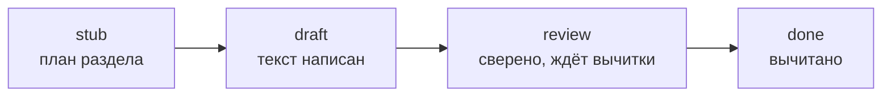

# Как вести справочник

Практическое руководство для владельца и соавторов: как запустить сайт локально, как писать страницы, как ставить задачи агентам и проверять их работу.

## Локальный запуск

```bash
python3 -m venv .venv
source .venv/bin/activate
pip install -r requirements.txt
mkdocs serve
```

Сайт откроется на <http://127.0.0.1:8000> и будет обновляться при каждом сохранении файла.

Перед коммитом запустите проверочную сборку. Она падает на битых ссылках, неизвестных источниках и ошибках в `nav`:

```bash
mkdocs build --strict
```

## Работа в Obsidian

1. Obsidian → *Open folder as vault* → выберите папку `docs/`.
2. Настройки ссылок уже лежат в `docs/.obsidian/`: обычные Markdown-ссылки вместо `[[вики-ссылок]]`, относительные пути.
3. Включите базовый плагин **Templates**. Папка шаблонов уже указана: `_templates`.
4. Новая страница: создать файл → *Insert template* → `page` (или `stub` для заготовки).

Что в Obsidian выглядит иначе, чем на сайте:

- плашку статуса сайт рисует сам, в Obsidian её нет — смотрите frontmatter;
- вставки `--8<-- "examples/..."` в Obsidian видны как строка, на сайте — как код;
- вкладки `=== "..."` в Obsidian видны как обычный текст с отступом.

## Жизненный цикл страницы



Отдельно от статуса растёт уровень проверки `verified`: `none` → `sources` → `emulator` → `hardware`. Подробно — в [Правилах оформления](conventions.md#frontmatter).

## Новая страница

1. Выберите раздел по таблице из [Правил оформления](conventions.md#разделы-что-куда-писать).
2. Создайте файл из шаблона. Имя — латиницей, `kebab-case`.
3. Добавьте страницу в `nav` в `mkdocs.yml`.
4. Добавьте ссылку на неё со страницы-оглавления раздела (`index.md`).
5. `mkdocs build --strict`.

## Работа с агентами

Агенты читают `AGENTS.md` (Claude Code — через `CLAUDE.md`). Там описаны правила и типовые задачи, поэтому в задаче достаточно сказать *что* сделать.

### Как ставить задачу

Одна страница — одна задача. Хорошая задача называет страницу, тип работы и, если есть, источники.

> [!example] Заполнить заготовку
> Заполни страницу `docs/hardware/io.md` (сейчас stub). Используй Plutiedev и Sega Genesis Software Manual. Нужны примеры чтения 3- и 6-кнопочного контроллера на ассемблере.

> [!example] Сверить страницу
> Сверь `docs/hardware/vdp/sprites.md` с документацией MacDonald и Plutiedev. Исправь ошибки, добавь сноски, расхождения опиши в плашке `question`. Подними `verified`, если всё сверено.

> [!example] Добавить пример
> Сделай пример `examples/sgdk/02-sprite-priority`: спрайт ходит за колонной (тайлы с P=1). Собери, запусти в BlastEm, приложи скриншот. Вставь пример в `docs/hardware/vdp/priority.md`.

### Как проверять работу агента

- [ ] Сборка `mkdocs build --strict` проходит (это же проверит CI в pull request).
- [ ] У новых фактов есть сноски, а ID источников есть в реестре.
- [ ] `verified` соответствует сделанному. Например, `emulator` без собранного примера — это ошибка.
- [ ] Выборочно проверьте 2–3 факта по источнику сами.
- [ ] Агент не трогал страницы вне задачи.
- [ ] В отчёте агента перечислено, что осталось непроверенным.

## Git и публикация

- Работайте в ветках и открывайте pull request. CI соберёт сайт в strict-режиме и покажет ошибки.
- После слияния в `main` сайт сам публикуется на GitHub Pages.

Первая настройка публикации:

1. Создайте репозиторий на GitHub и отправьте туда проект.
2. *Settings → Pages → Build and deployment → Source:* **GitHub Actions**.
3. Впишите `site_url` и `repo_url` в `mkdocs.yml`.

## Источники и архив

- Новый источник — сначала запись в [реестре](../sources/index.md).
- Мёртвая ссылка — найдите копию в [Wayback Machine](https://web.archive.org/) и впишите её в поле «Архив».
- Копии документов в `sources/` — только с разрешающей лицензией (см. `sources/README.md`).
