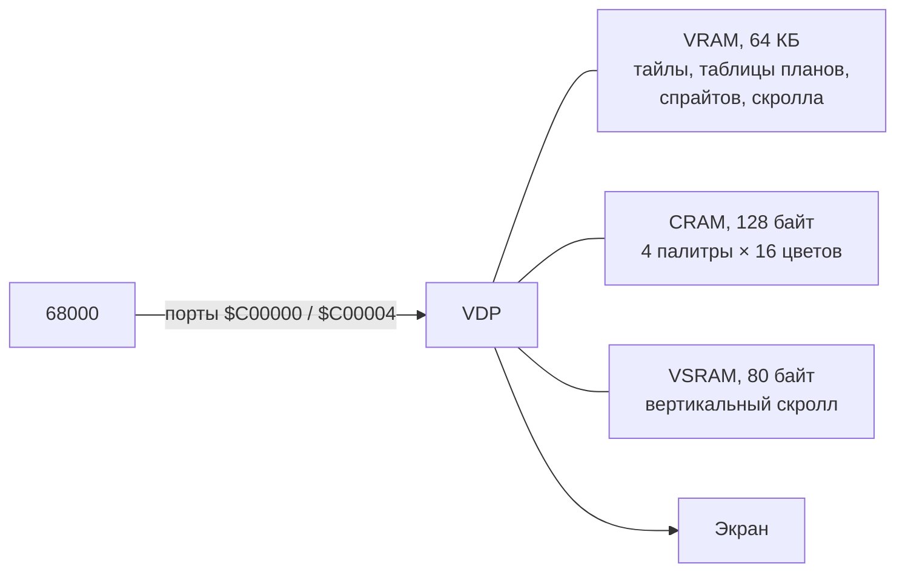

# VDP (видео)

VDP (Video Display Processor, чип Yamaha YM7101) — отдельный видеочип Mega Drive. Процессор 68000 не рисует пиксели сам: **кадрового буфера нет**. Программа раскладывает в видеопамять графические «кирпичики» (тайлы), карты фона и таблицу спрайтов, а VDP собирает из них изображение на лету, строка за строкой, прямо во время развёртки луча.

## Как устроено

### Память VDP

У VDP три собственные памяти. 68000 не видит их напрямую, доступ только через [порты](ports-and-commands.md):

| Память | Размер | Что хранит |
|---|---|---|
| VRAM | 64 КБ | [тайлы](tiles.md), таблицы [планов](planes.md), [таблицу спрайтов](sprites.md), таблицу [горизонтального скролла](scrolling.md) |
| CRAM | 64 слова (128 байт) | [4 палитры по 16 цветов](palettes.md) |
| VSRAM | 40 слов (80 байт) | значения [вертикального скролла](scrolling.md) |

### Порты

| Адрес | Назначение |
|---|---|
| `$C00000` | порт данных: запись и чтение памяти VDP |
| `$C00004` | порт управления: регистры, установка адреса, чтение статуса |
| `$C00008` | HV-счётчик: текущая строка и позиция луча |

### Разрешение экрана

| Режим | Ширина | Примечание |
|---|---|---|
| H40 | 320 пикселей = 40 клеток | используется почти всегда |
| H32 | 256 пикселей = 32 клетки | |

| Режим | Высота | Примечание |
|---|---|---|
| V28 | 224 строки = 28 клеток | NTSC и PAL |
| V30 | 240 строк = 30 клеток | только PAL |

### Из чего складывается картинка

Изображение собирается из нескольких слоёв:

| Слой | Что это |
|---|---|
| Цвет фона (backdrop) | один сплошной цвет под всеми слоями |
| [Plane B](planes.md) | прокручиваемый слой из тайлов, обычно дальний фон |
| [Plane A](planes.md) | прокручиваемый слой из тайлов, обычно передний план |
| [Window](window.md) | неподвижный слой, заменяет Plane A в части экрана |
| [Спрайты](sprites.md) | до 80 подвижных объектов |

Кто кого перекрывает, решают [приоритеты](priority.md): они задаются для каждой клетки и каждого спрайта отдельно.

## Как с этим работать

Типичный порядок работы:

1. При старте: настроить [регистры](registers.md) (режим экрана, адреса таблиц, размеры планов), загрузить [палитры](palettes.md) и [тайлы](tiles.md), заполнить [таблицы планов](planes.md).
2. Каждый кадр, во время отрисовки: игровая логика, подготовка таблицы спрайтов и значений скролла в RAM.
3. Каждый кадр, во время [VBlank](timing.md): перенести подготовленное в VRAM через [DMA](dma.md).

## Порядок чтения

Если вы знакомитесь с VDP впервые:

1. [Тайлы](tiles.md) — из чего строится любая графика
2. [Палитры и цвет фона](palettes.md)
3. [Планы A и B](planes.md) — как из тайлов строится фон
4. [Спрайты](sprites.md)
5. [Приоритеты](priority.md)
6. [Скроллинг](scrolling.md)
7. [Window](window.md)
8. [Порты и команды](ports-and-commands.md) — как всё это записать в VDP
9. [Регистры](registers.md) и [раскладка VRAM](vram-layout.md)
10. [Кадр, VBlank и прерывания](timing.md) и [DMA](dma.md)
11. [Shadow/Highlight](shadow-highlight.md)

## См. также

- [Калькулятор команд VDP](../../interactive/vdp-command.md)
- [Подводные камни](../../reference/pitfalls.md)
