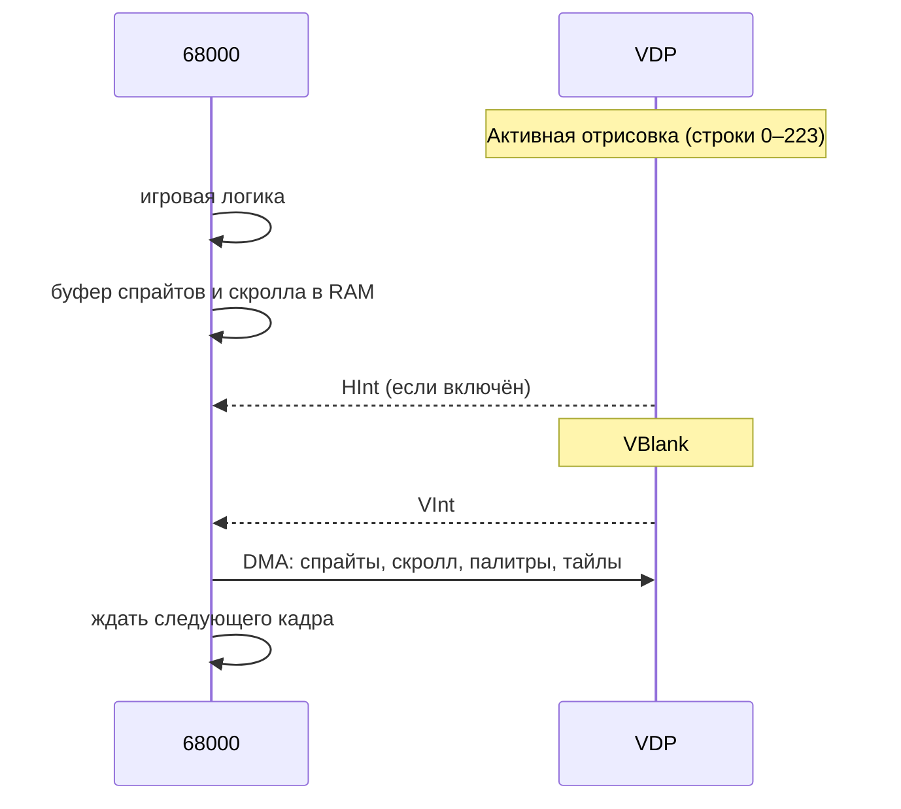

# Кадр, VBlank и прерывания

VDP рисует изображение строка за строкой, синхронно с лучом телевизора. Между строками и между кадрами есть паузы — HBlank и VBlank. Когда безопасно обращаться к VRAM и когда что-то менять, определяется именно этим.

## Как устроено

### Развёртка

Наследие ЭЛТ-телевизоров: луч рисует изображение слева направо и сверху вниз.

```
  ──────────────►  строка 0
  ◄ ─ ─ ─ ─ ─ ─    обратный ход по горизонтали (HBlank)
  ──────────────►  строка 1
  ...
  ──────────────►  строка 223 (последняя видимая в V28)
       ↑
       │ луч возвращается наверх (VBlank)
       │ изображение не рисуется
```

- **HBlank** — короткая пауза в конце каждой строки, пока луч возвращается влево.
- **VBlank** — длинная пауза после последней видимой строки, пока луч возвращается в верхний левый угол.

| | NTSC | PAL |
|---|---|---|
| Кадров в секунду | 60 | 50 |
| Строк в кадре | 262 | |
| Видимых строк (V28) | 224 | 224 (или 240 в V30) |
| Строк VBlank (V28) | около 38 | |

> [!todo] Дописать
> Число строк в кадре PAL, длительности HBlank и VBlank в тактах — по источникам.

### Почему важен VBlank

Пока рисуется видимая часть, VDP сам постоянно читает VRAM (тайлы, таблицы, спрайты), и процессору туда почти не протиснуться. Во время VBlank VDP изображение не рисует, и VRAM свободна. Отсюда правило:

> [!warning] Все крупные обновления VRAM — в VBlank
> Если менять таблицы посреди отрисовки, запись медленная, а кадр «рвётся»: верх нарисован по старым данным, низ — по новым.

### Прерывания

Прерывание — сигнал от VDP процессору: «отложи текущую работу, выполни обработчик, потом вернёшься». Без прерываний процессору пришлось бы постоянно опрашивать VDP и тратить на это время.

| Прерывание | Уровень 68000 | Когда | Включается |
|---|---|---|---|
| VInt | 6 | в начале VBlank, раз в кадр | бит 5 регистра `$01` |
| HInt | 4 | каждые N+1 строк | бит 4 регистра `$00` |
| внешнее | 2 | от устройства в порту ввода | |

### VInt (вертикальное)

Приходит 60 раз в секунду (50 на PAL). Это:

- сигнал «сейчас можно безопасно обновлять VRAM»;
- главный таймер игры: один VInt — один кадр.

### HInt (горизонтальное)

VDP считает строки. В [регистр](registers.md) `$0A` записывается N, и VDP вызывает прерывание каждые N+1 строк. Счётчик перезаряжается каждый кадр.

Зачем: **чтобы поменять что-то посреди кадра**, пока луч рисует экран. Если поменять настройки в начале строки 150, верх кадра будет нарисован со старыми, а низ — с новыми. Примеры:

- вода: ниже уровня воды подменяется палитра (см. [рецепт](../../cookbook/hint-palette-split.md));
- градиент неба: [цвет фона](palettes.md#цвет-фона-backdrop) меняется каждые несколько строк;
- разделённый экран: верх и низ с разными настройками скролла;
- смена вертикального скролла или границы Window посреди экрана.

> [!todo] Дописать
> Как получить одно прерывание на конкретной строке и когда именно перезаряжается счётчик — по источникам.

## Как с этим работать

Типичный игровой цикл:



1. **Во время кадра**: логика игры, расчёт позиций, заполнение буферов в RAM.
2. **В обработчике VInt**: [DMA](dma.md) буферов в VRAM, CRAM и VSRAM.

Без прерываний окончание кадра можно ждать опросом бита 3 [регистра статуса](ports-and-commands.md#регистр-статуса) (идёт VBlank).

## См. также

- [DMA](dma.md)
- [Смена палитры посреди кадра (вода)](../../cookbook/hint-palette-split.md)
- [Motorola 68000](../m68k.md) — таблица векторов прерываний
